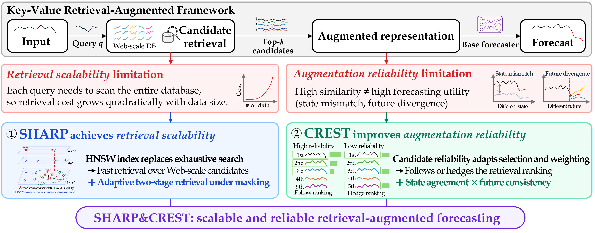

# SHARP and CREST

This repository provides RAFT, PIR and kNN-MTS integrations for **Scalable and Reliable Retrieval-Augmented Forecasting in Web-Scale Time Series Data**.

The paper introduces two complementary methods, applicable independently or together without changing the forecasting backbone:

- **SHARP** (Scalable Hierarchical Approximate Retrieval for Prediction) uses HNSW and adaptive two-stage retrieval to efficiently obtain valid candidates under temporal-overlap masking.
- **CREST** (Candidate Reliability Estimation with State Signatures and Trajectories) uses state agreement and candidate trajectories to adapt candidate selection and weighting. High reliability favors the retrieval ranking; low reliability encourages more diverse contributions.



## License

Project integration code uses the [MIT License](LICENSE). PIR/PatchTST retain the [THUML MIT notice](src/pir/LICENSE); DLinear retains its [Apache-2.0 license](src/knn_mts/LICENSE.dlinear). See [third-party attribution](THIRD_PARTY_NOTICES.txt). Quito TSF functions retain their [MIT notice](src/preprocessing/LICENSE.quito). Dataset licenses and attribution are listed in [data/web/ATTRIBUTION.txt](data/web/ATTRIBUTION.txt).

## Installation

Forecasting was validated with Python 3.9 and PyTorch 1.10. CUDA is used when available; add `--no_use_gpu` for CPU execution.

```bash
pip install -r requirements.txt
```

## Datasets

### Included forecasting data

Wiki and Quito-Hour are included under `data/web/`. Each has separate `100000.parquet`, `200000.parquet`, `400000.parquet`, and `800000.parquet` files containing complete train/validation/test series. Total size including metadata is approximately **10.42 MiB**. The default data root is the repository’s `data/` directory. Packaged Web data are selected automatically when no canonical path is supplied and `data/web/processed/` is absent.

| Dataset / CLI name | Input length | Forecast horizons | Series at 100K / 200K / 400K / 800K |
|---|---:|---|---|
| Quito-Hour / `quito_hour` | 576 | 48, 288, 512 | 10 / 18 / 36 / 73 |
| Extended Wikipedia / `extended_wikipedia` | 576 | 7, 28, 59 | 61 / 119 / 238 / 476 |
| TailedTS / `tailedts_202401` | 168 | 24, 48, 96 | 518 / 1,036 / — / — |

TailedTS data are external; its cohort manifests are included. Standard datasets are **ETTh1, ETTh2, ETTm1, ETTm2, Exchange, and Weather**, with horizons 96, 192, 336, and 720. Their CSV files are included under `data/general/ETT/` and `data/general/experiment/` (approximately **31.34 MiB**); SHA256 checksums are recorded in `data/general/checksums.json`.

The supplied cohorts are nested: each larger scale includes every series from the smaller scales, including the original 100K evaluation anchor. Series are never cut to meet an exact candidate count. Scale labels approximate candidate-window counts; changing the forecast horizon changes the actual count, not the selected series.

**No raw-data conversion or TSF preprocessing is required to run the included Wiki/Quito-Hour cohorts.** The Quick Start below explicitly selects `data/web` so it also works when another data directory exists locally.

To use another web-scale dataset, see [data/README.md](data/README.md) for the common Parquet schema, Quito conversion example, TSF analysis, and nested series selection. Custom dataset names are supported by preprocessing; forecasting a new dataset also requires a supported dataset configuration in `reproduce.py`.

## Experimental Results

The paper evaluates RAFT, kNN-MTS, and PIR. It reports up to **25.1×** faster retrieval-augmentation construction with SHARP at 1.6M entries, scalability to **12.8M** entries, and up to **54.8%** forecasting-error reduction with CREST. These are paper-wide results. The launcher defaults to RAFT; optional frameworks reproduce the PIR and DLinear + raw-window kNN-MTS RQ1 protocols.

`Base` denotes the original forecasting model; `+C`, `+S`, and `+S&C` add CREST, SHARP, and both modules, respectively. *H* is the forecast horizon. Time is in seconds; lower Time and MSE are better. Bold entries follow the paper.

### Table 7. Complete results on three Web-scale datasets

[Download Table 7 (CSV)](docs/tables/table7-web-scale.csv)

<table>
<thead>
<tr><th rowspan="2">Model</th><th rowspan="2">Config.</th><th colspan="3">Quito-Hour</th><th colspan="3">TailedTS</th><th colspan="3">Wikipedia</th></tr>
<tr><th><em>H</em></th><th>Time(s)</th><th>MSE</th><th><em>H</em></th><th>Time(s)</th><th>MSE</th><th><em>H</em></th><th>Time(s)</th><th>MSE</th></tr>
</thead>
<tbody>
<tr><th rowspan="12">RAFT</th><td><strong>Base</strong></td><td rowspan="4" align="center"><strong>48</strong></td><td align="right">195.1</td><td align="right">0.4359</td><td rowspan="4" align="center"><strong>24</strong></td><td align="right">289.7</td><td align="right">2.1745</td><td rowspan="4" align="center"><strong>7</strong></td><td align="right">177.2</td><td align="right">1.1407</td></tr>
<tr><td><strong>+C</strong></td><td align="right">211.3</td><td align="right">0.4365</td><td align="right">315.3</td><td align="right"><strong>2.1744</strong></td><td align="right">188.1</td><td align="right"><strong>1.0656</strong></td></tr>
<tr><td><strong>+S</strong></td><td align="right"><strong>63.8</strong></td><td align="right"><strong>0.4353</strong></td><td align="right"><strong>79.0</strong></td><td align="right">2.1746</td><td align="right"><strong>55.7</strong></td><td align="right">1.1382</td></tr>
<tr><td><strong>+S&amp;C</strong></td><td align="right">89.4</td><td align="right">0.4359</td><td align="right">107.6</td><td align="right"><strong>2.1744</strong></td><td align="right">75.2</td><td align="right">1.0743</td></tr>
<tr><td><strong>Base</strong></td><td rowspan="4" align="center"><strong>288</strong></td><td align="right">183.6</td><td align="right">0.4263</td><td rowspan="4" align="center"><strong>48</strong></td><td align="right">215.4</td><td align="right">2.3877</td><td rowspan="4" align="center"><strong>28</strong></td><td align="right">172.3</td><td align="right">0.6087</td></tr>
<tr><td><strong>+C</strong></td><td align="right">236.6</td><td align="right">0.4268</td><td align="right">241.0</td><td align="right"><strong>2.3872</strong></td><td align="right">186.0</td><td align="right"><strong>0.2963</strong></td></tr>
<tr><td><strong>+S</strong></td><td align="right"><strong>65.1</strong></td><td align="right"><strong>0.4258</strong></td><td align="right"><strong>66.7</strong></td><td align="right">2.3877</td><td align="right"><strong>55.2</strong></td><td align="right">0.6059</td></tr>
<tr><td><strong>+S&amp;C</strong></td><td align="right">125.3</td><td align="right">0.4265</td><td align="right">98.1</td><td align="right">2.3873</td><td align="right">78.0</td><td align="right">0.3018</td></tr>
<tr><td><strong>Base</strong></td><td rowspan="4" align="center"><strong>512</strong></td><td align="right">173.8</td><td align="right">0.4728</td><td rowspan="4" align="center"><strong>96</strong></td><td align="right">97.3</td><td align="right">2.2818</td><td rowspan="4" align="center"><strong>59</strong></td><td align="right">162.6</td><td align="right">0.6419</td></tr>
<tr><td><strong>+C</strong></td><td align="right">254.9</td><td align="right">0.4742</td><td align="right">124.3</td><td align="right"><strong>2.2814</strong></td><td align="right">179.9</td><td align="right">0.2901</td></tr>
<tr><td><strong>+S</strong></td><td align="right"><strong>66.3</strong></td><td align="right"><strong>0.4721</strong></td><td align="right"><strong>40.6</strong></td><td align="right">2.2818</td><td align="right"><strong>53.8</strong></td><td align="right">0.6405</td></tr>
<tr><td><strong>+S&amp;C</strong></td><td align="right">154.4</td><td align="right">0.4735</td><td align="right">73.8</td><td align="right"><strong>2.2814</strong></td><td align="right">78.3</td><td align="right"><strong>0.2875</strong></td></tr>
<tr><th rowspan="12">kNN-MTS</th><td><strong>Base</strong></td><td rowspan="4" align="center"><strong>48</strong></td><td align="right">76.5</td><td align="right">0.5014</td><td rowspan="4" align="center"><strong>24</strong></td><td align="right"><strong>27.6</strong></td><td align="right">2.4755</td><td rowspan="4" align="center"><strong>7</strong></td><td align="right">74.3</td><td align="right">0.2147</td></tr>
<tr><td><strong>+C</strong></td><td align="right">76.9</td><td align="right"><strong>0.4979</strong></td><td align="right">28.1</td><td align="right"><strong>2.4027</strong></td><td align="right">73.7</td><td align="right">0.2126</td></tr>
<tr><td><strong>+S</strong></td><td align="right"><strong>32.1</strong></td><td align="right">0.5015</td><td align="right">47.2</td><td align="right">2.4794</td><td align="right"><strong>27.3</strong></td><td align="right">0.2161</td></tr>
<tr><td><strong>+S&amp;C</strong></td><td align="right">32.5</td><td align="right">0.4984</td><td align="right">49.1</td><td align="right">2.4070</td><td align="right">27.6</td><td align="right"><strong>0.2107</strong></td></tr>
<tr><td><strong>Base</strong></td><td rowspan="4" align="center"><strong>288</strong></td><td align="right">73.4</td><td align="right">0.5120</td><td rowspan="4" align="center"><strong>48</strong></td><td align="right"><strong>25.7</strong></td><td align="right">2.6597</td><td rowspan="4" align="center"><strong>28</strong></td><td align="right">73.4</td><td align="right">0.2561</td></tr>
<tr><td><strong>+C</strong></td><td align="right">75.6</td><td align="right"><strong>0.5063</strong></td><td align="right">26.4</td><td align="right"><strong>2.5894</strong></td><td align="right">72.8</td><td align="right">0.2504</td></tr>
<tr><td><strong>+S</strong></td><td align="right"><strong>30.3</strong></td><td align="right">0.5134</td><td align="right">37.6</td><td align="right">2.6618</td><td align="right"><strong>26.4</strong></td><td align="right">0.2561</td></tr>
<tr><td><strong>+S&amp;C</strong></td><td align="right">31.7</td><td align="right">0.5069</td><td align="right">39.3</td><td align="right">2.5917</td><td align="right">26.6</td><td align="right"><strong>0.2501</strong></td></tr>
<tr><td><strong>Base</strong></td><td rowspan="4" align="center"><strong>512</strong></td><td align="right">73.0</td><td align="right">0.5808</td><td rowspan="4" align="center"><strong>96</strong></td><td align="right">22.7</td><td align="right">2.4046</td><td rowspan="4" align="center"><strong>59</strong></td><td align="right">72.8</td><td align="right">0.2666</td></tr>
<tr><td><strong>+C</strong></td><td align="right">74.9</td><td align="right"><strong>0.5710</strong></td><td align="right">23.6</td><td align="right">2.3923</td><td align="right">72.1</td><td align="right">0.2609</td></tr>
<tr><td><strong>+S</strong></td><td align="right"><strong>28.7</strong></td><td align="right">0.5793</td><td align="right"><strong>20.4</strong></td><td align="right">2.4037</td><td align="right"><strong>24.9</strong></td><td align="right">0.2676</td></tr>
<tr><td><strong>+S&amp;C</strong></td><td align="right">30.6</td><td align="right">0.5739</td><td align="right">21.8</td><td align="right"><strong>2.3917</strong></td><td align="right">25.2</td><td align="right"><strong>0.2604</strong></td></tr>
<tr><th rowspan="12">PIR</th><td><strong>Base</strong></td><td rowspan="4" align="center"><strong>48</strong></td><td align="right">121.2</td><td align="right">0.4322</td><td rowspan="4" align="center"><strong>24</strong></td><td align="right">214.6</td><td align="right">2.2204</td><td rowspan="4" align="center"><strong>7</strong></td><td align="right">104.9</td><td align="right">0.1982</td></tr>
<tr><td><strong>+C</strong></td><td align="right">128.2</td><td align="right">0.4286</td><td align="right">222.4</td><td align="right"><strong>2.2150</strong></td><td align="right">111.7</td><td align="right"><strong>0.1965</strong></td></tr>
<tr><td><strong>+S</strong></td><td align="right"><strong>62.5</strong></td><td align="right">0.4324</td><td align="right"><strong>76.4</strong></td><td align="right">2.2203</td><td align="right"><strong>55.5</strong></td><td align="right">0.1982</td></tr>
<tr><td><strong>+S&amp;C</strong></td><td align="right">70.4</td><td align="right"><strong>0.4284</strong></td><td align="right">81.7</td><td align="right"><strong>2.2150</strong></td><td align="right">63.3</td><td align="right"><strong>0.1965</strong></td></tr>
<tr><td><strong>Base</strong></td><td rowspan="4" align="center"><strong>288</strong></td><td align="right">111.9</td><td align="right">0.4498</td><td rowspan="4" align="center"><strong>48</strong></td><td align="right">147.8</td><td align="right">2.3609</td><td rowspan="4" align="center"><strong>28</strong></td><td align="right">100.3</td><td align="right">0.2250</td></tr>
<tr><td><strong>+C</strong></td><td align="right">122.4</td><td align="right"><strong>0.4486</strong></td><td align="right">158.9</td><td align="right">2.3603</td><td align="right">107.3</td><td align="right"><strong>0.2247</strong></td></tr>
<tr><td><strong>+S</strong></td><td align="right"><strong>60.5</strong></td><td align="right">0.4494</td><td align="right"><strong>62.3</strong></td><td align="right">2.3609</td><td align="right"><strong>54.2</strong></td><td align="right">0.2250</td></tr>
<tr><td><strong>+S&amp;C</strong></td><td align="right">72.1</td><td align="right"><strong>0.4486</strong></td><td align="right">67.5</td><td align="right"><strong>2.3602</strong></td><td align="right">61.6</td><td align="right">0.2249</td></tr>
<tr><td><strong>Base</strong></td><td rowspan="4" align="center"><strong>512</strong></td><td align="right">102.0</td><td align="right">0.5208</td><td rowspan="4" align="center"><strong>96</strong></td><td align="right">55.1</td><td align="right">2.2458</td><td rowspan="4" align="center"><strong>59</strong></td><td align="right">91.9</td><td align="right">0.2308</td></tr>
<tr><td><strong>+C</strong></td><td align="right">117.0</td><td align="right">0.5269</td><td align="right">62.0</td><td align="right"><strong>2.2451</strong></td><td align="right">97.8</td><td align="right"><strong>0.2306</strong></td></tr>
<tr><td><strong>+S</strong></td><td align="right"><strong>57.7</strong></td><td align="right"><strong>0.5183</strong></td><td align="right"><strong>36.6</strong></td><td align="right">2.2458</td><td align="right"><strong>52.0</strong></td><td align="right">0.2308</td></tr>
<tr><td><strong>+S&amp;C</strong></td><td align="right">72.7</td><td align="right">0.5278</td><td align="right">40.5</td><td align="right"><strong>2.2451</strong></td><td align="right">59.6</td><td align="right"><strong>0.2306</strong></td></tr>
</tbody>
</table>

### Table 8. Complete results on six standard datasets

[Download Table 8 (CSV)](docs/tables/table8-standard.csv)

<table>
<thead>
<tr><th rowspan="2">Model</th><th rowspan="2">Config.</th><th rowspan="2"><em>H</em></th><th colspan="2">ETTh1</th><th colspan="2">ETTh2</th><th colspan="2">ETTm1</th><th colspan="2">ETTm2</th><th colspan="2">Weather</th><th colspan="2">Exchange</th></tr>
<tr><th>Time(s)</th><th>MSE</th><th>Time(s)</th><th>MSE</th><th>Time(s)</th><th>MSE</th><th>Time(s)</th><th>MSE</th><th>Time(s)</th><th>MSE</th><th>Time(s)</th><th>MSE</th></tr>
</thead>
<tbody>
<tr><th rowspan="16">RAFT</th><td><strong>Base</strong></td><td rowspan="4" align="center"><strong>96</strong></td><td align="right"><strong>2.6</strong></td><td align="right"><strong>0.3790</strong></td><td align="right"><strong>2.6</strong></td><td align="right">0.2778</td><td align="right">39.3</td><td align="right">0.3005</td><td align="right"><strong>39.3</strong></td><td align="right">0.1650</td><td align="right"><strong>107.7</strong></td><td align="right">0.1696</td><td align="right"><strong>1.0</strong></td><td align="right">0.2120</td></tr>
<tr><td><strong>+C</strong></td><td align="right">9.4</td><td align="right">0.3798</td><td align="right">9.3</td><td align="right"><strong>0.2760</strong></td><td align="right">61.8</td><td align="right"><strong>0.2984</strong></td><td align="right">61.4</td><td align="right"><strong>0.1639</strong></td><td align="right">134.2</td><td align="right"><strong>0.1695</strong></td><td align="right">5.3</td><td align="right">0.2077</td></tr>
<tr><td><strong>+S</strong></td><td align="right">7.3</td><td align="right"><strong>0.3790</strong></td><td align="right">7.2</td><td align="right">0.2778</td><td align="right"><strong>34.7</strong></td><td align="right">0.3005</td><td align="right">48.6</td><td align="right">0.1650</td><td align="right">154.0</td><td align="right">0.1702</td><td align="right">1.6</td><td align="right">0.2119</td></tr>
<tr><td><strong>+S&amp;C</strong></td><td align="right">14.3</td><td align="right">0.3798</td><td align="right">13.9</td><td align="right"><strong>0.2760</strong></td><td align="right">58.4</td><td align="right"><strong>0.2984</strong></td><td align="right">69.9</td><td align="right">0.1640</td><td align="right">189.2</td><td align="right">0.1697</td><td align="right">5.7</td><td align="right"><strong>0.2076</strong></td></tr>
<tr><td><strong>Base</strong></td><td rowspan="4" align="center"><strong>192</strong></td><td align="right"><strong>2.6</strong></td><td align="right"><strong>0.4089</strong></td><td align="right"><strong>2.6</strong></td><td align="right">0.3470</td><td align="right">39.5</td><td align="right">0.3307</td><td align="right"><strong>39.2</strong></td><td align="right">0.2183</td><td align="right"><strong>108.1</strong></td><td align="right"><strong>0.2123</strong></td><td align="right"><strong>1.0</strong></td><td align="right">0.3366</td></tr>
<tr><td><strong>+C</strong></td><td align="right">9.5</td><td align="right">0.4095</td><td align="right">9.4</td><td align="right">0.3419</td><td align="right">62.6</td><td align="right"><strong>0.3298</strong></td><td align="right">62.5</td><td align="right"><strong>0.2176</strong></td><td align="right">137.8</td><td align="right">0.2129</td><td align="right">5.3</td><td align="right"><strong>0.3335</strong></td></tr>
<tr><td><strong>+S</strong></td><td align="right">8.0</td><td align="right"><strong>0.4089</strong></td><td align="right">7.5</td><td align="right">0.3502</td><td align="right"><strong>35.7</strong></td><td align="right">0.3307</td><td align="right">50.1</td><td align="right">0.2183</td><td align="right">155.5</td><td align="right">0.2128</td><td align="right">1.7</td><td align="right">0.3367</td></tr>
<tr><td><strong>+S&amp;C</strong></td><td align="right">14.5</td><td align="right">0.4095</td><td align="right">14.2</td><td align="right"><strong>0.3418</strong></td><td align="right">59.7</td><td align="right">0.3299</td><td align="right">71.5</td><td align="right"><strong>0.2176</strong></td><td align="right">192.9</td><td align="right">0.2131</td><td align="right">5.8</td><td align="right">0.3336</td></tr>
<tr><td><strong>Base</strong></td><td rowspan="4" align="center"><strong>336</strong></td><td align="right"><strong>2.6</strong></td><td align="right"><strong>0.4362</strong></td><td align="right"><strong>2.6</strong></td><td align="right">0.3766</td><td align="right">39.2</td><td align="right">0.3545</td><td align="right"><strong>39.1</strong></td><td align="right">0.2724</td><td align="right"><strong>113.8</strong></td><td align="right"><strong>0.2601</strong></td><td align="right"><strong>1.0</strong></td><td align="right">0.4768</td></tr>
<tr><td><strong>+C</strong></td><td align="right">9.7</td><td align="right">0.4373</td><td align="right">9.6</td><td align="right">0.3701</td><td align="right">63.3</td><td align="right"><strong>0.3543</strong></td><td align="right">63.2</td><td align="right">0.2706</td><td align="right">149.5</td><td align="right">0.2615</td><td align="right">5.3</td><td align="right"><strong>0.4735</strong></td></tr>
<tr><td><strong>+S</strong></td><td align="right">8.0</td><td align="right"><strong>0.4362</strong></td><td align="right">8.1</td><td align="right">0.3766</td><td align="right"><strong>37.0</strong></td><td align="right">0.3545</td><td align="right">50.4</td><td align="right">0.2724</td><td align="right">163.2</td><td align="right">0.2610</td><td align="right">1.9</td><td align="right">0.4771</td></tr>
<tr><td><strong>+S&amp;C</strong></td><td align="right">13.9</td><td align="right">0.4373</td><td align="right">14.2</td><td align="right"><strong>0.3700</strong></td><td align="right">60.6</td><td align="right"><strong>0.3543</strong></td><td align="right">72.7</td><td align="right"><strong>0.2705</strong></td><td align="right">203.8</td><td align="right">0.2621</td><td align="right">6.0</td><td align="right">0.4736</td></tr>
<tr><td><strong>Base</strong></td><td rowspan="4" align="center"><strong>720</strong></td><td align="right"><strong>2.9</strong></td><td align="right"><strong>0.4659</strong></td><td align="right"><strong>2.9</strong></td><td align="right">0.4232</td><td align="right"><strong>40.7</strong></td><td align="right">0.4054</td><td align="right"><strong>40.4</strong></td><td align="right">0.3631</td><td align="right"><strong>124.4</strong></td><td align="right"><strong>0.3267</strong></td><td align="right"><strong>1.1</strong></td><td align="right">0.9306</td></tr>
<tr><td><strong>+C</strong></td><td align="right">10.3</td><td align="right">0.4679</td><td align="right">10.3</td><td align="right">0.4107</td><td align="right">68.3</td><td align="right"><strong>0.4050</strong></td><td align="right">68.1</td><td align="right"><strong>0.3577</strong></td><td align="right">195.0</td><td align="right">0.3282</td><td align="right">5.5</td><td align="right">0.9156</td></tr>
<tr><td><strong>+S</strong></td><td align="right">10.3</td><td align="right"><strong>0.4659</strong></td><td align="right">10.5</td><td align="right">0.4232</td><td align="right">41.3</td><td align="right">0.4054</td><td align="right">53.9</td><td align="right">0.3630</td><td align="right">178.6</td><td align="right">0.3273</td><td align="right">2.2</td><td align="right">0.9294</td></tr>
<tr><td><strong>+S&amp;C</strong></td><td align="right">15.6</td><td align="right">0.4678</td><td align="right">16.0</td><td align="right"><strong>0.4106</strong></td><td align="right">66.5</td><td align="right"><strong>0.4050</strong></td><td align="right">78.7</td><td align="right"><strong>0.3577</strong></td><td align="right">249.5</td><td align="right">0.3286</td><td align="right">6.5</td><td align="right"><strong>0.9144</strong></td></tr>
<tr><th rowspan="16">kNN-MTS</th><td><strong>Base</strong></td><td rowspan="4" align="center"><strong>96</strong></td><td align="right">61.0</td><td align="right">0.4182</td><td align="right">59.7</td><td align="right">0.2946</td><td align="right">82.9</td><td align="right">0.3540</td><td align="right">83.7</td><td align="right">0.1777</td><td align="right">133.5</td><td align="right">0.1985</td><td align="right">42.4</td><td align="right">0.1953</td></tr>
<tr><td><strong>+C</strong></td><td align="right">60.3</td><td align="right">0.4120</td><td align="right">61.0</td><td align="right">0.2953</td><td align="right">84.3</td><td align="right">0.3465</td><td align="right">84.5</td><td align="right"><strong>0.1730</strong></td><td align="right">137.6</td><td align="right"><strong>0.1947</strong></td><td align="right">42.9</td><td align="right">0.1880</td></tr>
<tr><td><strong>+S</strong></td><td align="right"><strong>6.1</strong></td><td align="right">0.4186</td><td align="right"><strong>5.3</strong></td><td align="right"><strong>0.2945</strong></td><td align="right"><strong>30.8</strong></td><td align="right">0.3551</td><td align="right"><strong>32.5</strong></td><td align="right">0.1784</td><td align="right"><strong>100.0</strong></td><td align="right">0.2015</td><td align="right"><strong>0.9</strong></td><td align="right">0.1957</td></tr>
<tr><td><strong>+S&amp;C</strong></td><td align="right">6.5</td><td align="right"><strong>0.4118</strong></td><td align="right">5.7</td><td align="right">0.2951</td><td align="right">32.4</td><td align="right"><strong>0.3464</strong></td><td align="right">34.3</td><td align="right">0.1732</td><td align="right">102.4</td><td align="right">0.1968</td><td align="right">1.1</td><td align="right"><strong>0.1874</strong></td></tr>
<tr><td><strong>Base</strong></td><td rowspan="4" align="center"><strong>192</strong></td><td align="right">60.5</td><td align="right">0.4532</td><td align="right">60.3</td><td align="right">0.3819</td><td align="right">84.6</td><td align="right">0.3920</td><td align="right">82.0</td><td align="right">0.2447</td><td align="right">132.5</td><td align="right">0.2482</td><td align="right">42.1</td><td align="right">0.3068</td></tr>
<tr><td><strong>+C</strong></td><td align="right">59.4</td><td align="right"><strong>0.4467</strong></td><td align="right">60.6</td><td align="right">0.3826</td><td align="right">85.5</td><td align="right"><strong>0.3829</strong></td><td align="right">84.0</td><td align="right"><strong>0.2385</strong></td><td align="right">137.7</td><td align="right"><strong>0.2411</strong></td><td align="right">42.1</td><td align="right">0.2932</td></tr>
<tr><td><strong>+S</strong></td><td align="right"><strong>5.9</strong></td><td align="right">0.4534</td><td align="right"><strong>5.0</strong></td><td align="right"><strong>0.3811</strong></td><td align="right"><strong>30.4</strong></td><td align="right">0.3935</td><td align="right"><strong>32.1</strong></td><td align="right">0.2457</td><td align="right"><strong>99.1</strong></td><td align="right">0.2536</td><td align="right"><strong>0.8</strong></td><td align="right">0.3067</td></tr>
<tr><td><strong>+S&amp;C</strong></td><td align="right">6.6</td><td align="right"><strong>0.4467</strong></td><td align="right">5.7</td><td align="right">0.3822</td><td align="right">33.3</td><td align="right">0.3831</td><td align="right">34.9</td><td align="right">0.2393</td><td align="right">105.2</td><td align="right">0.2442</td><td align="right">1.1</td><td align="right"><strong>0.2930</strong></td></tr>
<tr><td><strong>Base</strong></td><td rowspan="4" align="center"><strong>336</strong></td><td align="right">58.8</td><td align="right">0.4809</td><td align="right">59.8</td><td align="right">0.4700</td><td align="right">83.4</td><td align="right">0.4234</td><td align="right">83.4</td><td align="right">0.3063</td><td align="right">132.8</td><td align="right">0.3132</td><td align="right">40.2</td><td align="right">0.4051</td></tr>
<tr><td><strong>+C</strong></td><td align="right">59.8</td><td align="right">0.4734</td><td align="right">61.3</td><td align="right">0.4718</td><td align="right">86.4</td><td align="right"><strong>0.4129</strong></td><td align="right">85.0</td><td align="right"><strong>0.3009</strong></td><td align="right">140.8</td><td align="right"><strong>0.3023</strong></td><td align="right">42.0</td><td align="right"><strong>0.3911</strong></td></tr>
<tr><td><strong>+S</strong></td><td align="right"><strong>5.6</strong></td><td align="right">0.4805</td><td align="right"><strong>4.8</strong></td><td align="right"><strong>0.4682</strong></td><td align="right"><strong>30.2</strong></td><td align="right">0.4255</td><td align="right"><strong>32.1</strong></td><td align="right">0.3082</td><td align="right"><strong>98.2</strong></td><td align="right">0.3220</td><td align="right"><strong>0.8</strong></td><td align="right">0.4057</td></tr>
<tr><td><strong>+S&amp;C</strong></td><td align="right">6.7</td><td align="right"><strong>0.4729</strong></td><td align="right">5.9</td><td align="right">0.4711</td><td align="right">34.8</td><td align="right">0.4138</td><td align="right">36.5</td><td align="right">0.3024</td><td align="right">107.1</td><td align="right">0.3062</td><td align="right">1.2</td><td align="right">0.3916</td></tr>
<tr><td><strong>Base</strong></td><td rowspan="4" align="center"><strong>720</strong></td><td align="right">56.3</td><td align="right">0.5194</td><td align="right">56.3</td><td align="right">0.6185</td><td align="right">83.6</td><td align="right">0.4753</td><td align="right">83.5</td><td align="right">0.4187</td><td align="right">131.8</td><td align="right">0.3906</td><td align="right">37.4</td><td align="right">0.7118</td></tr>
<tr><td><strong>+C</strong></td><td align="right">59.5</td><td align="right"><strong>0.5106</strong></td><td align="right">57.3</td><td align="right">0.6264</td><td align="right">90.1</td><td align="right"><strong>0.4614</strong></td><td align="right">89.3</td><td align="right"><strong>0.4083</strong></td><td align="right">149.9</td><td align="right"><strong>0.3758</strong></td><td align="right">38.1</td><td align="right"><strong>0.6870</strong></td></tr>
<tr><td><strong>+S</strong></td><td align="right"><strong>4.9</strong></td><td align="right">0.5192</td><td align="right"><strong>4.3</strong></td><td align="right"><strong>0.6164</strong></td><td align="right"><strong>29.4</strong></td><td align="right">0.4784</td><td align="right"><strong>31.7</strong></td><td align="right">0.4217</td><td align="right"><strong>96.3</strong></td><td align="right">0.3990</td><td align="right"><strong>0.6</strong></td><td align="right">0.7159</td></tr>
<tr><td><strong>+S&amp;C</strong></td><td align="right">6.5</td><td align="right"><strong>0.5106</strong></td><td align="right">6.0</td><td align="right">0.6245</td><td align="right">37.9</td><td align="right">0.4637</td><td align="right">40.0</td><td align="right">0.4106</td><td align="right">112.8</td><td align="right">0.3812</td><td align="right">1.0</td><td align="right">0.6872</td></tr>
<tr><th rowspan="16">PIR</th><td><strong>Base</strong></td><td rowspan="4" align="center"><strong>96</strong></td><td align="right"><strong>0.8</strong></td><td align="right"><strong>0.3731</strong></td><td align="right"><strong>0.8</strong></td><td align="right"><strong>0.2921</strong></td><td align="right">10.6</td><td align="right"><strong>0.3161</strong></td><td align="right">10.7</td><td align="right">0.1725</td><td align="right">28.6</td><td align="right"><strong>0.1768</strong></td><td align="right"><strong>0.3</strong></td><td align="right">0.2068</td></tr>
<tr><td><strong>+C</strong></td><td align="right">1.6</td><td align="right">0.3757</td><td align="right">1.5</td><td align="right">0.2922</td><td align="right">13.5</td><td align="right">0.3180</td><td align="right">13.7</td><td align="right"><strong>0.1721</strong></td><td align="right">37.3</td><td align="right">0.1874</td><td align="right">0.8</td><td align="right"><strong>0.2063</strong></td></tr>
<tr><td><strong>+S</strong></td><td align="right">1.2</td><td align="right"><strong>0.3731</strong></td><td align="right">1.4</td><td align="right"><strong>0.2921</strong></td><td align="right"><strong>5.2</strong></td><td align="right"><strong>0.3161</strong></td><td align="right"><strong>6.4</strong></td><td align="right">0.1738</td><td align="right"><strong>16.0</strong></td><td align="right">0.1782</td><td align="right">0.7</td><td align="right">0.2068</td></tr>
<tr><td><strong>+S&amp;C</strong></td><td align="right">2.2</td><td align="right">0.3757</td><td align="right">2.4</td><td align="right">0.2927</td><td align="right">8.8</td><td align="right">0.3171</td><td align="right">10.1</td><td align="right">0.1729</td><td align="right">26.3</td><td align="right">0.1876</td><td align="right">1.3</td><td align="right"><strong>0.2063</strong></td></tr>
<tr><td><strong>Base</strong></td><td rowspan="4" align="center"><strong>192</strong></td><td align="right"><strong>0.8</strong></td><td align="right"><strong>0.4227</strong></td><td align="right"><strong>0.8</strong></td><td align="right">0.3738</td><td align="right">10.8</td><td align="right">0.3615</td><td align="right">11.0</td><td align="right">0.2378</td><td align="right">28.9</td><td align="right"><strong>0.2217</strong></td><td align="right"><strong>0.3</strong></td><td align="right"><strong>0.3471</strong></td></tr>
<tr><td><strong>+C</strong></td><td align="right">2.2</td><td align="right">0.4241</td><td align="right">2.3</td><td align="right"><strong>0.3733</strong></td><td align="right">16.6</td><td align="right"><strong>0.3606</strong></td><td align="right">16.6</td><td align="right"><strong>0.2369</strong></td><td align="right">44.9</td><td align="right">0.2328</td><td align="right">1.1</td><td align="right">0.3477</td></tr>
<tr><td><strong>+S</strong></td><td align="right">1.3</td><td align="right"><strong>0.4227</strong></td><td align="right">1.4</td><td align="right">0.3738</td><td align="right"><strong>5.4</strong></td><td align="right">0.3616</td><td align="right"><strong>6.5</strong></td><td align="right">0.2381</td><td align="right"><strong>16.4</strong></td><td align="right">0.2221</td><td align="right">0.7</td><td align="right">0.3472</td></tr>
<tr><td><strong>+S&amp;C</strong></td><td align="right">2.8</td><td align="right">0.4241</td><td align="right">2.9</td><td align="right">0.3738</td><td align="right">11.6</td><td align="right">0.3608</td><td align="right">12.8</td><td align="right">0.2375</td><td align="right">33.9</td><td align="right">0.2328</td><td align="right">1.6</td><td align="right">0.3477</td></tr>
<tr><td><strong>Base</strong></td><td rowspan="4" align="center"><strong>336</strong></td><td align="right"><strong>0.9</strong></td><td align="right"><strong>0.4696</strong></td><td align="right"><strong>0.9</strong></td><td align="right">0.4186</td><td align="right">10.8</td><td align="right">0.3948</td><td align="right">10.9</td><td align="right">0.3109</td><td align="right">29.4</td><td align="right">0.2866</td><td align="right"><strong>0.4</strong></td><td align="right">0.4574</td></tr>
<tr><td><strong>+C</strong></td><td align="right">3.3</td><td align="right">0.4699</td><td align="right">3.3</td><td align="right"><strong>0.4163</strong></td><td align="right">21.1</td><td align="right"><strong>0.3936</strong></td><td align="right">21.1</td><td align="right">0.3114</td><td align="right">57.6</td><td align="right">0.2848</td><td align="right">1.7</td><td align="right"><strong>0.4570</strong></td></tr>
<tr><td><strong>+S</strong></td><td align="right">1.3</td><td align="right"><strong>0.4696</strong></td><td align="right">1.4</td><td align="right">0.4186</td><td align="right"><strong>5.5</strong></td><td align="right">0.3949</td><td align="right"><strong>6.7</strong></td><td align="right">0.3094</td><td align="right"><strong>17.1</strong></td><td align="right">0.2885</td><td align="right">0.7</td><td align="right">0.4575</td></tr>
<tr><td><strong>+S&amp;C</strong></td><td align="right">3.7</td><td align="right">0.4699</td><td align="right">3.9</td><td align="right">0.4171</td><td align="right">15.8</td><td align="right">0.3941</td><td align="right">17.0</td><td align="right"><strong>0.3089</strong></td><td align="right">45.2</td><td align="right"><strong>0.2847</strong></td><td align="right">2.0</td><td align="right">0.4574</td></tr>
<tr><td><strong>Base</strong></td><td rowspan="4" align="center"><strong>720</strong></td><td align="right"><strong>1.0</strong></td><td align="right"><strong>0.4885</strong></td><td align="right"><strong>0.9</strong></td><td align="right">0.4236</td><td align="right">11.3</td><td align="right">0.4605</td><td align="right">11.4</td><td align="right">0.4516</td><td align="right">30.3</td><td align="right">0.3624</td><td align="right"><strong>0.4</strong></td><td align="right"><strong>0.9502</strong></td></tr>
<tr><td><strong>+C</strong></td><td align="right">5.4</td><td align="right">0.4915</td><td align="right">5.4</td><td align="right"><strong>0.4216</strong></td><td align="right">31.3</td><td align="right"><strong>0.4587</strong></td><td align="right">31.2</td><td align="right">0.4838</td><td align="right">86.1</td><td align="right">0.3610</td><td align="right">2.6</td><td align="right">0.9545</td></tr>
<tr><td><strong>+S</strong></td><td align="right">1.5</td><td align="right">0.4886</td><td align="right">1.7</td><td align="right">0.4245</td><td align="right"><strong>6.2</strong></td><td align="right">0.4605</td><td align="right"><strong>7.4</strong></td><td align="right"><strong>0.4392</strong></td><td align="right"><strong>19.1</strong></td><td align="right">0.3632</td><td align="right">0.7</td><td align="right">0.9511</td></tr>
<tr><td><strong>+S&amp;C</strong></td><td align="right">5.9</td><td align="right">0.4915</td><td align="right">6.1</td><td align="right">0.4257</td><td align="right">26.3</td><td align="right">0.4588</td><td align="right">27.5</td><td align="right">0.4631</td><td align="right">74.1</td><td align="right"><strong>0.3608</strong></td><td align="right">3.0</td><td align="right">0.9560</td></tr>
</tbody>
</table>

## Quick Start

### 1. Verify the included data

Run the examples from the repository root. The implementation is under `src/`; the root entrypoint and training script require no `PYTHONPATH` changes.

```bash
python reproduce.py --dataset extended_wikipedia --scale 200000 --pred_len 7 \
  --canonical_root data/web --prepare_only --output outputs/wiki-check
```

This checks cohort, normalization, and available reference query/target hashes without retrieval or training.

### 2. Train and evaluate

Use `scripts/train_forecasting.py` to choose the data type, directory, dataset, and method. Each invocation prepares retrieval, trains the model, and evaluates the best-validation checkpoint.

For the supplied Wiki 200K cohort, H=7:

```bash
python scripts/train_forecasting.py --data-type web --data-dir data/web \
  --dataset extended_wikipedia --scale 200000 --pred-len 7 \
  --method 'S&C' --seed 42 --output outputs/wiki-200k-H7-SC-seed42
```

Set `--scale` to `100000`, `200000`, `400000`, or `800000`. For Quito-Hour, use `--dataset quito_hour --pred-len 288`; other paper horizons are listed above. Web `--data-dir` points to the root containing dataset directories, either the supplied `data/web` or an external common-Parquet root. TailedTS requires external data. All supplied scales retain the 100K evaluation anchor.

Choose one of the four methods:

| `--method` | Configuration |
|---|---|
| `RAFT` | RAFT with exact retrieval |
| `SHARP` | RAFT + SHARP |
| `CREST` | RAFT + CREST with exact retrieval |
| `'S&C'` | RAFT + SHARP & CREST |

For a General dataset, point `--data-dir` directly to the directory containing its CSV:

```bash
python scripts/train_forecasting.py --data-type general --data-dir data/general/ETT \
  --dataset ETTh1 --pred-len 96 --method SHARP --seed 42 \
  --output outputs/ETTh1-H96-SHARP-seed42
```

ETTh1/ETTh2/ETTm1/ETTm2 use `data/general/ETT`; Exchange/Weather use `data/general/experiment`. Expected filenames are `<dataset>.csv` for ETT and `<dataset>_wide.csv` for Exchange/Weather. Omit `--scale` for General datasets.

Change `--method`, `--seed`, and `--pred-len` for another run. Add `--dry-run` to validate the configuration without retrieval or training. Extra `reproduce.py` options go after `--`, for example `-- --no_use_gpu --save_predictions` or `-- --train_epochs 20`. The launcher uses the active Python environment and preserves the existing model, retrieval, and training defaults. Use `python scripts/train_forecasting.py --help` for launcher options.

Use a new output directory for each run. Outputs include `metrics.json`, `timing.json`, training history, and the best-validation checkpoint. `--save_predictions` also saves predictions. Web-scale comparisons use **`fixed_test_MSE` / `fixed_test_MAE`** on the original 100K anchor series; `full_test_MSE` / `full_test_MAE` cover the selected population. These MSE/MAE values use train-only normalization.

## PIR and kNN-MTS RQ1

Add `--framework pir` or `--framework knn_mts` to the same launcher. Methods are
`BASE`, `SHARP`, `CREST`, and `'S&C'`; `PIR`/`KNN` are framework-specific baseline aliases.
Existing RAFT commands remain valid. Install the selected optional dependencies:

```bash
pip install -r requirements-pir.txt
pip install -r requirements-knn-mts.txt
```

```bash
python scripts/train_forecasting.py --framework pir --data-type web --data-dir data/web \
  --dataset extended_wikipedia --pred-len 7 --method 'S&C' --seed 0 \
  --output outputs/pir-wiki-H7-s0-SC
python scripts/train_forecasting.py --framework knn_mts --data-type general --data-dir data/general \
  --dataset ETTh1 --pred-len 96 --method CREST --seed 0 \
  --output outputs/knn-ETTh1-H96-s0-CREST
```

## File Descriptions

- `scripts/train_forecasting.py`: configurable Web/General training launcher.
- `reproduce.py`, `src/reproduction/`: experiment entrypoint, configuration, evaluation, and grids.
- `src/pir/`, `src/knn_mts/`: independent model runners, retrieval and training implementations.
- `src/models/RAFT.py`, `src/layers/Retrieval.py`: forecasting model and retrieval integration.
- `src/utils/panel_crest.py`, `src/utils/stp_reliability.py`, `src/utils/value_mmr.py`: CREST components.
- `src/preprocessing/`: Quito conversion, TSF analysis, and nested selection.
- `data/general/`, `data/web/`: General CSVs and packaged Web cohorts; [data/README.md](data/README.md) explains preprocessing.
- `configs/cohorts/`: frozen series identities and reference hashes.

## RAFT Reproduction Options

CLI options override JSON presets supplied with `--config`. Use `--help` for all parameters.

| Setting | CLI parameter(s) |
|---|---|
| Model seed / horizon / scale | `seed`, `pred_len`, `scale` |
| Selected k / candidate pool C / reliability neighborhood N | `topm`, `mmr_candidate_pool`, `profile_reliability_k` |
| STP level / transition / dispersion weights | `stp_state_weight`, `stp_transition_weight`, `stp_dispersion_weight` |
| HNSW graph / construction / search | `hnsw_m`, `hnsw_ef_construction`, `hnsw_ef_search` |
| Initial search multiplier / strategy | `hnsw_oversample_factor`, `candidate_search_strategy` |
| Query / MMR batch sizes | `retrieval_batch_size`, `value_mmr_chunk_size` |

The paper uses k=40, C=100, N=40 and initial multiplier 5. STP weights default to `.5/.25/.25` for level/transition/dispersion and can be overridden through CLI options. Model seeds do not change cohorts. Web grids use seeds 0/1/42; General grids use 0/1/2. See `python -m src.reproduction.sweep --help` for grid options.

`--retrieval_only` skips training while measuring candidate/index preparation and train/validation/test retrieval. Numerical CPU threads default to 32 during preparation and 4 during training; HNSW thread settings are separate. Multithreaded HNSW construction and numerical environments can cause variation across runs.

## Public Release Files

[PUBLIC_FILES.txt](PUBLIC_FILES.txt) lists the exact publication file set. See [the release guide](docs/PUBLIC_RELEASE.md) to export only these files and verify a standalone copy.
